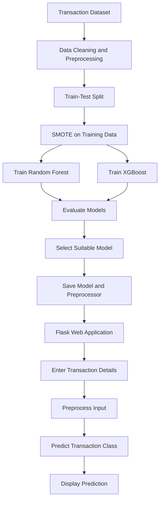

# 💳 Credit Card Fraud Detection Using Machine Learning

An intelligent machine learning system that identifies potentially fraudulent credit card transactions using **Random Forest and XGBoost classifiers**. The project addresses class imbalance using **SMOTE**, evaluates model performance using standard classification metrics, and integrates the trained model into a **Flask-based web application** for real-time transaction prediction.

<p align="center">

  

  

  

  

</p>

---

## 📌 Table of Contents

- [Project Overview](#-project-overview)
- [Objectives](#-objectives)
- [Key Features](#-key-features)
- [Technologies Used](#-technologies-used)
- [Project Workflow](#-project-workflow)
- [Project Structure](#-project-structure)
- [Installation and Setup](#-installation-and-setup)
- [Running the Application](#-running-the-application)
- [Model Evaluation](#-model-evaluation)
- [How It Works](#-how-it-works)
- [Future Enhancements](#-future-enhancements)
- [Disclaimer](#-disclaimer)
- [Author](#-author)

---

## 📖 Project Overview

Credit card fraud is a major challenge in digital financial transactions. Fraudulent activities can cause financial losses and reduce customer trust. Machine learning provides an effective approach to identifying suspicious transaction patterns and classifying transactions based on their characteristics.

This project implements a machine learning-based fraud detection system that processes transaction-related features and predicts whether a transaction is potentially **legitimate or fraudulent**.

The system uses SMOTE to address class imbalance in the training dataset and trains two classification algorithms: Random Forest and XGBoost. Their performance is evaluated using accuracy, precision, recall, F1-score, and a confusion matrix.

The selected trained model is saved and integrated into a Flask web application, allowing users to enter transaction details and obtain a prediction.

## 🎯 Objectives

- Develop a machine learning model to detect potentially fraudulent credit card transactions.
- Handle imbalanced transaction data using the Synthetic Minority Over-sampling Technique (SMOTE).
- Train and compare Random Forest and XGBoost classifiers.
- Evaluate model performance using standard classification metrics.
- Save trained models and preprocessing objects for reuse.
- Develop a Flask-based web interface for transaction prediction.

## ✨ Key Features

- **Fraud Classification:** Predicts whether a transaction is potentially fraudulent or legitimate.
- **Class Imbalance Handling:** Uses SMOTE to increase representation of the minority class during training.
- **Model Comparison:** Implements Random Forest and XGBoost classification algorithms.
- **Performance Evaluation:** Supports accuracy, precision, recall, F1-score, and confusion matrix analysis.
- **Model Persistence:** Saves trained models and preprocessing components for future predictions.
- **Web-Based Interface:** Provides a user interface built with Flask, HTML, and CSS.
- **Reusable Prediction Pipeline:** Separates prediction logic from the web application.

## 🛠️ Technologies Used

| Category | Technologies |
|---|---|
| Programming Language | Python |
| Machine Learning | Scikit-learn, XGBoost |
| Data Processing | Pandas, NumPy |
| Class Imbalance | SMOTE, imbalanced-learn |
| Web Framework | Flask |
| Frontend | HTML, CSS |
| Model Serialization | Joblib, XGBoost JSON |
| Development Environment | Google Colab, Visual Studio Code |
| Version Control | Git, GitHub |

## 🔄 Project Workflow

The project follows a structured machine learning pipeline, from transaction data preparation to deployment through a web interface.



**Important:** SMOTE must be applied only to the training data, after splitting the original dataset. The test set should retain its original class distribution to ensure a meaningful evaluation.

## 📂 Project Structure

```text
credit-card-fraud-detector/
│
├── models/
│   ├── preprocessor.pkl
│   ├── xgb_classifier.json
│   ├── fraud_detection_model.pkl
│   └── fraud_detection_model_backup.pkl
│
├── notebooks/
│   └── EDPProjectNEW12Oct.ipynb
│
├── src/
│   └── predict.py
│
├── templates/
│   └── index.html
│
├── app.py
├── requirements.txt
├── .gitignore
└── README.md
```

### Directory Description

- `models/` — Stores the trained classification models and preprocessing artifacts.
- `notebooks/` — Contains the notebook used for data analysis, training, and evaluation.
- `src/predict.py` — Contains prediction-related logic.
- `templates/index.html` — Defines the web interface.
- `app.py` — Runs the Flask application and handles prediction requests.
- `requirements.txt` — Lists the Python dependencies.
- `.gitignore` — Specifies files and directories Git should ignore.
- `README.md` — Documents the project and setup instructions.

*The structure above reflects the supplied project layout; individual filenames should match the files present in your repository.*

## ⚙️ Installation and Setup

Follow these steps to run the project on your local machine.

### Prerequisites

Ensure that the following software is installed:

- Python 3.10 or a compatible version supported by your dependencies
- Git
- pip

### 1. Clone the Repository

```bash
git clone https://github.com/yuvasai6456/EDP_WEEK_10.git
```

Navigate to the project directory:

```bash
cd EDP_WEEK_10
```

### 2. Create a Virtual Environment

```bash
python -m venv .venv
```

### 3. Activate the Virtual Environment

**Windows — Command Prompt**

```cmd
.venv\Scripts\activate
```

**Windows — PowerShell**

```powershell
.\.venv\Scripts\Activate.ps1
```

**Linux / macOS**

```bash
source .venv/bin/activate
```

### 4. Install Dependencies

```bash
python -m pip install --upgrade pip
pip install -r requirements.txt
```

Make sure `requirements.txt` contains all the packages required by your application, including Flask, pandas, NumPy, scikit-learn, XGBoost, imbalanced-learn, and Joblib wherever they are used.

## 🚀 Running the Application

After installing the dependencies, start the Flask server:

```bash
python app.py
```

Open your browser and visit:

**http://127.0.0.1:5000**

Enter the required transaction details in the web interface and submit them to obtain the model's prediction.

The application must have access to the saved model and preprocessing artifacts expected by the prediction code.

## 📊 Model Evaluation

The project evaluates the Random Forest and XGBoost classifiers using the following metrics.

| Metric | Description |
|---|---|
| Accuracy | Measures the proportion of correctly classified transactions. |
| Precision | Measures how many transactions predicted as fraudulent are actually fraudulent. |
| Recall | Measures how many actual fraudulent transactions are correctly identified. |
| F1-Score | Calculates the harmonic mean of precision and recall. |
| Confusion Matrix | Shows correct and incorrect predictions for each class. |

### Why These Metrics Matter

Credit card fraud datasets often contain significantly fewer fraudulent transactions than legitimate transactions. Therefore, a model may achieve high accuracy while failing to detect a large proportion of fraud cases.

**Precision and recall are especially important** because false fraud alerts can inconvenience legitimate customers, while missed fraudulent transactions can result in financial losses.

The final model should be selected based on the evaluation results and the project's fraud detection priorities, rather than accuracy alone.

> **Note:** Insert the actual evaluation results from the completed training notebook when they are available. No performance scores are assumed in this README.

## 🧠 How It Works

1. **Input:** Transaction-related features are collected from the dataset or web form.
2. **Preprocessing:** Numerical and categorical features are transformed into the format expected by the trained model.
3. **Prediction:** The selected classifier analyzes the processed transaction features.
4. **Classification:** The model predicts the transaction class.
5. **Output:** The Flask application displays the prediction to the user.

The output represents a machine learning prediction and should not be treated as a definitive confirmation of fraud.

## 🔮 Future Enhancements

- Add an interactive dashboard for transaction monitoring.
- Display model evaluation metrics and confusion matrices in the web interface.
- Improve model selection using precision-recall analysis and cross-validation.
- Add probability scores and configurable fraud alert thresholds.
- Deploy the application to a cloud platform.
- Implement secure input validation, logging, and error handling.
- Evaluate model performance on unseen and real-world transaction data.

## ⚠️ Disclaimer

This project is intended for educational and academic purposes. Predictions depend on the quality of the dataset, the selected features, and the trained model. The application is not a substitute for a production-grade fraud detection system or professional financial risk assessment.

## 👨‍💻 Author

**Chinta N V S Teja**

Credit Card Fraud Detection Using Machine Learning

---

<p align="center">
  <i>Built to explore machine learning techniques for identifying potentially fraudulent financial transactions.</i>
</p>
